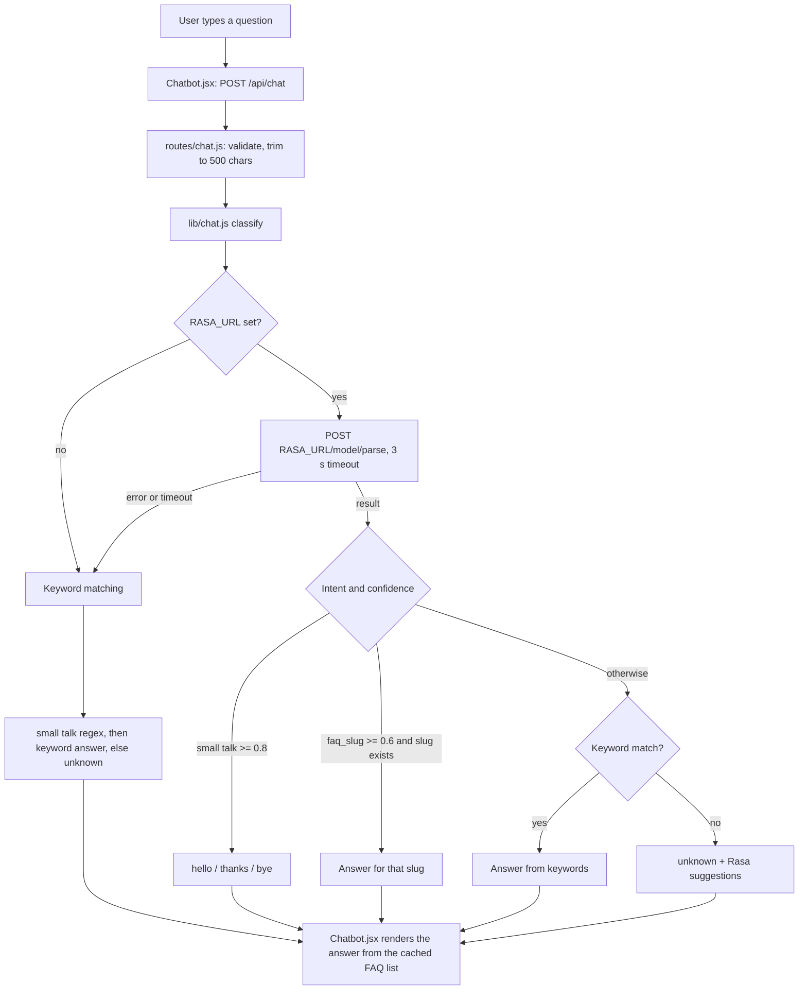

# Help Chatbot with Rasa

The chatbot answers library questions (borrowing, returns, renewals, fines, hours, theses and so on) in English, Filipino and Taglish. **Rasa** understands what the user is asking. **The database** supplies the answer.

## Why Rasa only picks the topic

Rasa's NLU model classifies a message into a topic (an *intent*). It does not write the reply. The reply text is a help answer stored in MongoDB (`faqs` collection) that librarians edit under **Admin > Help answers**.

This keeps the bot safe for a library: it can never invent a loan period or a fine, and changing a policy is an edit in the admin page, not a retraining job.

## Request flow



The client loads the full FAQ list once when the chat opens (`GET /api/faq`). `/api/chat` returns only a *decision* (`kind` plus a `slug`), and the client looks the answer up in that list.

## Components

| File | Role |
| --- | --- |
| `rasa/config.yml` | NLU pipeline and training settings |
| `rasa/data/nlu.yml` | Training examples: one intent per help answer, plus small talk and out-of-scope |
| `scripts/rasa.js` | Cross-platform helper to install, train and run Rasa from npm scripts |
| `server/src/lib/chat.js` | `classify()`: combines Rasa's result with keyword matching |
| `server/src/routes/chat.js` | `POST /api/chat` endpoint |
| `server/src/config.js` | `rasaUrl` setting |
| `server/src/models/index.js` | `Faq` model (the answers) |
| `client/src/components/Chatbot.jsx` | Chat window UI |

## The Rasa model

### Pipeline (`rasa/config.yml`)

| Component | Purpose |
| --- | --- |
| `WhitespaceTokenizer` | Splits text into words |
| `RegexFeaturizer`, `LexicalSyntacticFeaturizer` | Pattern and word-shape features |
| `CountVectorsFeaturizer` (words) | Bag-of-words features |
| `CountVectorsFeaturizer` (`char_wb`, n-grams 1 to 4) | Character features, so typos and Filipino word forms such as *hiram*, *humiram*, *nanghiram* still match |
| `DIETClassifier` (100 epochs, fixed seed 42) | Learns the intent from the examples. The fixed seed makes training repeatable |
| `FallbackClassifier` (threshold 0.5) | Reports `nlu_fallback` when no intent reaches 50% |

`policies` is `null` because only NLU is used. There are no dialogue stories, rules or custom actions, which keeps the model small and fast to train (about a minute).

### Intents (`rasa/data/nlu.yml`)

| Intent | Meaning |
| --- | --- |
| `greet`, `thank`, `goodbye` | Small talk |
| `out_of_scope` | Messages the library bot should not answer ("what is the weather", random keystrokes). Giving the model examples of what *not* to answer prevents confident wrong answers |
| `faq_<slug>` (13 of them) | One per help answer. `<slug>` must equal the slug of a document in the `faqs` collection |

Current FAQ intents: `faq_borrow`, `faq_return`, `faq_renew`, `faq_fines`, `faq_lost`, `faq_reserve`, `faq_hours`, `faq_card`, `faq_thesis`, `faq_submit`, `faq_embargo`, `faq_cite`, `faq_contact`.

Each intent has examples in English, Filipino and Taglish.

## Decision logic (`server/src/lib/chat.js`)

`classify(text, faqs)` returns a decision object. Thresholds are constants at the top of the file.

| Constant | Value | Meaning |
| --- | --- | --- |
| `CONFIDENT` | 0.6 | Minimum confidence to trust a `faq_*` intent |
| `SMALL_TALK_CONFIDENT` | 0.8 | Higher bar for greetings and thanks. A stray word read as "thanks" would end the conversation, so small talk must be certain |
| `SUGGEST` | 0.1 | Minimum confidence for a "Did you mean" suggestion |
| Rasa timeout | 3000 ms | In `rasaParse()`. A slow Rasa must never freeze the chat |

Order of decisions when Rasa answers:

1. Small-talk intent with confidence at least 0.8 returns `hello`, `thanks` or `bye`.
2. A `faq_<slug>` intent with confidence at least 0.6, **and** a matching slug in the database, returns `faq` with that slug. The slug check means a deleted help answer cannot be returned by a stale model.
3. Otherwise Rasa is unsure. Keyword matching runs next. It also catches help answers added after the model was last trained.
4. If keywords find nothing, the result is `unknown` with up to three suggestions: the highest-ranked `faq_*` intents with confidence at least 0.1.

### Keyword matching

`keywordMatch()` is the fallback and the safety net.

- The message is lower-cased and reduced to letters, digits and apostrophes.
- Each FAQ has a `keywords` list. A keyword matches when it appears at the **start of a word** (`reserv` matches *reserve*, *reservation*).
- A keyword with a **trailing space** matches a whole word only (`"late "` matches *late* but not *translate*).
- A multi-word keyword scores 3; a single word scores 2. The FAQ with the highest total wins. Ties go to the first.

When Rasa is not used at all, small talk is detected with a small regular expression (`hi`, `hello`, `kumusta`, `thanks`, `salamat`, `bye`, `paalam`).

## API contract

`POST /api/chat` with body `{ "message": "..." }`. An empty message returns 400. Messages are trimmed and cut to 500 characters.

Responses:

```json
{ "engine": "rasa", "intent": "faq_hours", "confidence": 0.93, "kind": "faq", "slug": "hours" }
```
```json
{ "engine": "keywords", "kind": "faq", "slug": "borrow" }
```
```json
{ "engine": "rasa", "intent": "thank", "confidence": 0.97, "kind": "thanks" }
```
```json
{ "engine": "rasa", "intent": "nlu_fallback", "confidence": 0.5, "kind": "unknown", "suggestions": ["card", "renew"] }
```

| Field | Values |
| --- | --- |
| `engine` | `rasa` or `keywords`: which one produced the decision |
| `kind` | `faq`, `hello`, `thanks`, `bye`, `unknown` |
| `slug` | Present when `kind` is `faq` |
| `suggestions` | Present when `kind` is `unknown`: FAQ slugs to offer |
| `intent`, `confidence` | Rasa's top intent and its confidence (0 to 1). Absent when keywords decided |

## When Rasa is unavailable

The chatbot never depends on Rasa being up.

| Situation | Behaviour |
| --- | --- |
| `RASA_URL` empty (for example on Vercel) | Keywords only, no network call |
| Rasa not running, refused connection, timeout, or non-200 response | `rasaParse()` returns `null` and keywords take over |
| Rasa up but unsure | Keywords, then suggestions |
| `/api/chat` itself fails | The chat window shows "I can't reach the help service right now" |

`config.rasaUrl` defaults to `http://localhost:5005` locally and to empty when the `VERCEL` environment variable is present. Setting `RASA_URL` explicitly overrides both. An explicitly empty value disables Rasa.

## Chat window (`client/src/components/Chatbot.jsx`)

- **Opening** the window fetches `GET /api/faq` once and shows a welcome message with starter topic buttons (borrow, return, renew, fines, hours, thesis).
- **Asking** a question appends the user's message, shows a typing indicator, calls `POST /api/chat`, then appends the bot's reply. Any failure becomes the `error` reply.
- **Rendering a reply** depends on `kind`:
  - `faq`: the answer text, converted to paragraphs and bullet lists (blank lines separate paragraphs, lines starting with `- ` become bullets), followed by related-question buttons and links.
  - `unknown`: with suggestions, "Did you mean one of these?" plus the suggested topics and a contact button; without, a pointer to the circulation desk.
  - `hello`, `thanks`, `bye`: short replies with topic buttons.
- **Labels:** answers marked as sample policy show "Sample policy. Confirm with the circulation desk." Answers decided by Rasa show "Understood by Rasa AI, N% sure".
- **Accessibility:** the log is an `aria-live` region, the input is focused when the window opens, and Escape closes it.
- **Responsive:** on phones held upright it becomes a full-screen sheet; in landscape it is a side panel. See [frontend.md](frontend.md).

## Running Rasa

Rasa 3.6 needs **Python 3.8, 3.9 or 3.10** and about 2 GB of disk space.

```bash
npm run rasa:install   # creates rasa/.venv and installs Rasa (once)
npm run rasa:train     # trains rasa/models/nlu-<timestamp>.tar.gz
npm run rasa           # serves the newest model on http://localhost:5005
```

`scripts/rasa.js` checks the Python version, creates the virtual environment, locates the right executable for Windows or macOS/Linux, and refuses to run with a clear message if Rasa is not installed or no model has been trained. The virtual environment and models are not committed (`.gitignore`).

Start the website as usual (`npm run dev`); the API finds Rasa automatically.

You can query Rasa directly to see how it reads a sentence:

```bash
curl -X POST http://localhost:5005/model/parse -d '{"text": "pwede ba humiram ng libro"}'
```

## Maintaining the chatbot

| Goal | Steps |
| --- | --- |
| Change an answer's wording | Admin > Help answers. No retraining |
| Add a new help answer that works immediately | Add it in Admin > Help answers with keywords. The keyword fallback serves it right away |
| Make Rasa recognise the new answer | Add an intent `faq_<slug>` to `rasa/data/nlu.yml` with at least 10 varied example questions (English, Filipino, Taglish), run `npm run rasa:train`, restart `npm run rasa` |
| Fix a question that is answered wrongly | Add that question (and close variations) as examples of the correct intent, retrain |
| Stop it answering something off-topic | Add examples to `out_of_scope`, retrain |
| Tune strictness | Adjust the constants at the top of `server/src/lib/chat.js`. Raise `CONFIDENT` for fewer but safer answers; lower it for more answers |

Training tips: write examples the way students actually type, include misspellings and Taglish, and keep intents balanced in size. When a new example is added to one intent, check that a similar phrase is not already an example of another.

## Security and limits

- The Rasa server has no authentication in this setup. Keep port 5005 reachable only from the API server, never from the public internet.
- User text is sent to Rasa for classification only and is not stored by the API.
- Vercel cannot run a Python server. To use Rasa in a hosted deployment, run it on a separate machine with at least 2 GB of memory and set `RASA_URL` in the Vercel project to that address. Until then the hosted site uses keyword matching.

## Tests

`server/test/api.test.js` covers the chatbot with `RASA_URL` forced empty so the suite never depends on a running Rasa. One test checks:

1. Keyword matching with Rasa off, and a 400 for an empty message.
2. Rasa decisions, using a small fake HTTP server that imitates `/model/parse` (confident FAQ, confident small talk, unsure with suggestions, an unknown slug being ignored).
3. Rasa configured but unreachable: the keyword fallback still answers.
