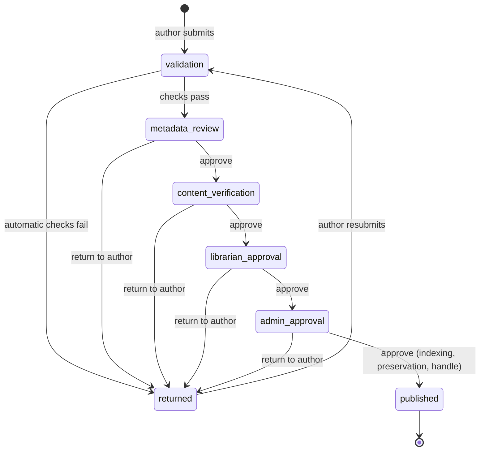

# Submission Workflow and Access Control

Two modules decide what happens to a thesis and who may read it:

- `server/src/lib/workflow.js`: how a submission moves from "submitted" to "published".
- `server/src/lib/access.js`: who may see a record and download its file.

## Roles

| Role | How obtained | Can do |
| --- | --- | --- |
| Guest (not signed in) | Default | Search, browse, read published records, download open-access files |
| Student, Faculty | Self-registration | Everything a guest can, plus submit work, fix returned submissions, download institutional files, request restricted files |
| Librarian | Assigned by an administrator | Everything above, plus review and catalog submissions, approve the first three review stages, decide access requests, edit help answers |
| Admin | Assigned by an administrator | Everything above, plus final approval, reports, user and collection management |

`STAFF_ROLES` (`librarian`, `admin`) is defined in `server/src/constants.js`.

## Workflow stages

The stages are defined in order in `STAGES` (`constants.js`). Each item carries two fields:

- `stage`: where it is in the pipeline.
- `status`: `in_review`, `returned`, `published` or `withdrawn`.

| # | Stage key | Label | Who acts | Automatic |
| --- | --- | --- | --- | --- |
| 1 | `submitted` | Submitted | Author | |
| 2 | `validation` | Initial validation | System | Yes |
| 3 | `metadata_review` | Metadata review | Librarian or admin | |
| 4 | `content_verification` | Content verification | Librarian or admin | |
| 5 | `librarian_approval` | Librarian approval | Librarian or admin | |
| 6 | `admin_approval` | Admin approval | Admin only | |
| 7 | `indexing` | Metadata indexing | System | Yes |
| 8 | `preservation` | Digital preservation | System | Yes |
| 9 | `published` | Published | System | Yes |

### Who can act at each stage

`APPROVERS` in `workflow.js` maps each manual stage to the roles allowed to approve it. `admin_approval` lists only `admin`; the other three allow `librarian` and `admin`. Changing who can approve a stage means editing that one object.

- `canApprove(item, user)`: true when the item is `in_review` and the user's role is allowed at the current stage.
- `canReturn(item, user)`: true when the item is `in_review`, at a manual stage, and the user is a librarian or admin.

The review routes use both functions and also send them to the client (`canApprove`, `canReturn`) so the buttons appear only when the action is allowed.

### Functions

| Function | What it does |
| --- | --- |
| `validate(item)` | Runs the automatic checks and returns a list of problems in plain language |
| `submit(item, user, { resubmission })` | Records the submission, runs `validate`, then either returns the item to the author or moves it to `metadata_review` |
| `approve(item, user, note)` | Logs the approval and advances one stage. At `admin_approval` it calls `publish` |
| `returnToAuthor(item, user, note)` | Sets `status` to `returned` and logs the librarian's note |
| `publish(item)` | Indexing, preservation and publication in one step (below) |

### Automatic validation

`validate()` checks that the item has:

- a title and at least one author,
- an abstract of at most 300 words (`ABSTRACT_WORD_LIMIT`),
- at least three keywords,
- a future end date, when the access level is embargo,
- an uploaded file whose first bytes are the `%PDF-` signature (so a renamed non-PDF is rejected).

Any problem sets `status` to `returned`, stores the list in `item.issues` and logs it. The author sees the list under **My submissions**, fixes the record and resubmits.

### Publication

After admin approval, `publish()`:

1. Sets `stage` to `indexing` and logs it. The MongoDB text index updates by itself, so no separate indexing job exists.
2. Sets `stage` to `preservation` and runs a fixity check on every file: it recomputes the SHA-256 and compares it with the stored value, recording `fixityOk` and `lastFixityCheck`. If any file fails, an error is thrown and publication stops. Because the handler saves the item only after `approve` returns, a failed check leaves the stored item unchanged.
3. Sets `status` to `published`, stamps `publishedAt`, and assigns a permanent **handle** if the item has none.

Handles look like `20.500.12345/4817` and resolve at `/handle/20.500.12345/4817`. `nextHandle()` atomically increments a counter document (`findOneAndUpdate` with `$inc` and `upsert`), so two items approved at the same moment never receive the same number. The prefix comes from `HANDLE_PREFIX`.

### History

Every event is appended to `item.history` with the stage, an action (`submitted`, `validated`, `approved`, `returned`, `resubmitted`, `indexed`, `preserved`, `published`, `edited`), the acting user (or "System"), a note and a timestamp. This is the audit trail for the proposal's SUBMISSION and APPROVAL tables.

### Resubmission and versions

When an author fixes a returned item (`PUT /api/submissions/:id`), a new file is stored as the next version (`version + 1`) and the old one is kept. `submit()` is called again with `resubmission: true`, which restarts validation.

## Access levels

Access levels are defined in `ACCESS_LEVELS` (`constants.js`) and enforced by `downloadAccess()` in `access.js`.

| Level | Record visible | Full text | Result `reason` when blocked |
| --- | --- | --- | --- |
| `open` | Everyone | Everyone | |
| `institutional` | Everyone | Any signed-in user | `sign_in` |
| `restricted` | Everyone | Signed-in user with an **approved** access request | `sign_in`, `request`, `pending` |
| `embargo` | Everyone | Locked until `embargoUntil`, then open automatically | `embargo` |
| `metadata_only` | Everyone | Nobody online | `metadata_only` |

Staff and the item's owner always have access, whatever the level. Items that are not yet published return `not_published` to everyone else.

`canViewRecord()` decides whether a record can be seen at all: published records are public; unpublished ones are visible only to staff and the owner. For anyone else the API answers 404, so the existence of unpublished work is not revealed.

### Restricted items

A signed-in user submits a reason (at least 10 characters) through `POST /api/items/:id/access-requests`, which creates an `AccessRequest` with status `pending`. A librarian approves or denies it under the review area. `downloadAccess()` looks at the user's most recent request: `approved` grants access, `pending` reports `pending`, anything else reports `request` (with `denied: true` when previously refused). A user cannot open a second request while one is pending.

### The download endpoint

`GET /api/items/:id/files/:fileId` calls `downloadAccess()` and, when blocked, returns 401 for `sign_in` and 403 otherwise, with a plain-language message for each reason. When allowed, it streams the file from GridFS and, for published items downloaded by non-staff, increments `downloads` and writes an `AccessLog` entry. `?inline=1` serves PDFs for in-browser viewing instead of as an attachment.

Views are counted when a published record is opened by someone who is not staff and not the owner, so staff reviewing records do not inflate the statistics.
